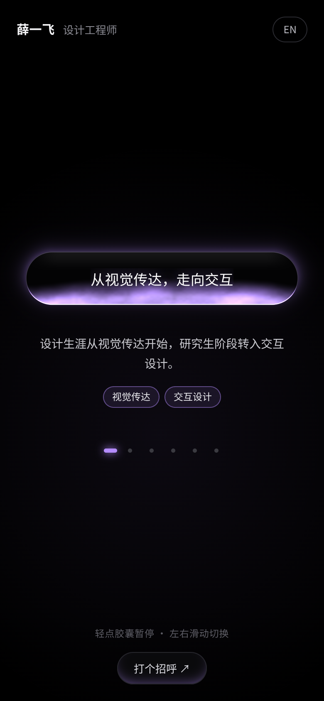

# glow-pill-career

**一颗会说话的胶囊** — a black-glass glowing pill that types out the career of **薛一飞 Allen Xue**, a design engineer.

Live: https://glow-pill-career.pages.dev



## 中文

**这是什么**：一个单屏小 demo。屏幕中央是一颗不透明的黑色玻璃胶囊，光像液体一样积在它的底边；胶囊逐字打出我的职业节点，每换一句，一股颜色就沿着玻璃涌上来。

- 自动循环打字；每次切换都有一次色彩涌动
- 轻点胶囊：暂停，并在下方展开这一段的一句话叙述和关键词；再点继续
- 左右滑动或方向键：上一段 / 下一段；底部小圆点可直接跳转
- 「打个招呼」：打开 xyf.design（素材里没有公开邮箱，所以没做复制邮箱）
- 中 / 英切换（默认中文）；`prefers-reduced-motion` 下为静态光晕、不打字；WebGL 不可用时退回 CSS 渐变

**和我的关系**：这是我自己的 demo，讲的是我真实的路径：视觉传达 → 研究生转交互 → IBM、微软亚洲研究院实习 → 字节跳动飞书（飞书任务、Universe Design 官网）→ 2022 年快手 KID 设计中台（设计系统、组件化、工程化）→ 2023 年百度 MEUX（内容生态设计系统）→ 现在的小米 HyperOS 设计系统与设计工程（Token、组件、Figma 插件、AI 工作流，只写公开描述）。

**运行**：

```bash
npm i
npm run dev      # 本地开发
npm run build    # 产出 dist/
```

光效是一段手写的 WebGL 片元着色器（`src/glow.ts`，单 pass，无 three.js）。依赖只有 react、react-dom、vite、typescript、@vitejs/plugin-react。

## English

**What it is**: a single-screen demo. An opaque black-glass stadium with liquid light pooled along its bottom edge types through my career milestones; every phrase swap sends a surge of color up the glass. Tap to pause and read the one-line story + keywords; swipe or use arrow keys to browse; toggle zh/en. Reduced-motion gets a static glow; no-WebGL gets a CSS gradient fallback.

**Relationship to me**: it’s my own demo and my real story — visual communication → interaction design in grad school → IBM and Microsoft Research Asia internships → ByteDance Feishu → Kuaishou KID design platform (2022) → Baidu MEUX (2023) → Xiaomi HyperOS design systems & design engineering (public description only).

**Run**: `npm i`, `npm run dev`, `npm run build`.

**Deploy**: `scripts/build-pages-worker.mjs` packs `dist/` into a `_worker.js` for a Cloudflare Pages direct deployment (build-time helper only, not shipped in the app).

## Credits

Visual idea inspired by **Glow Pill** from movements.dev — https://www.movements.dev/glow-pill. The shader here is an independent implementation.
